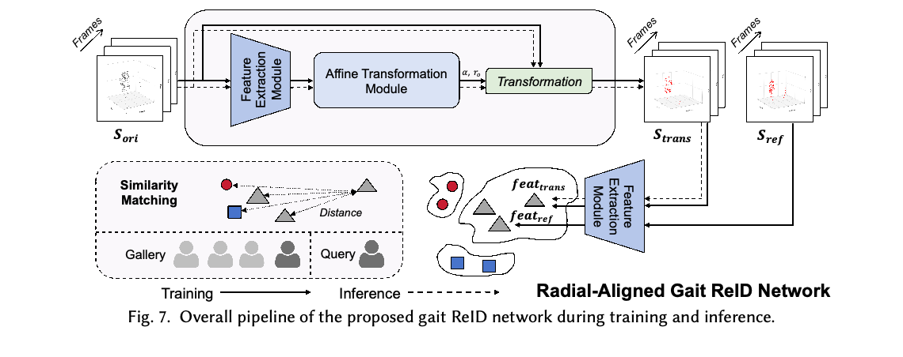
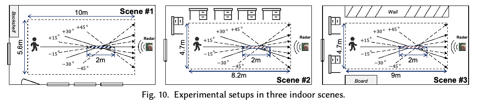
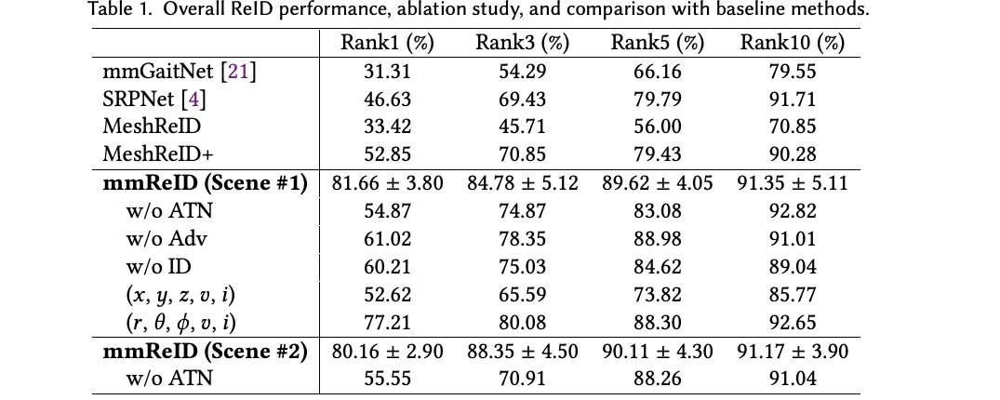

# Overview

Millimeter-wave radar can sense gait without relying on lighting or visible clothing appearance. However, the same person's radar signature changes substantially with walking direction: radar measures radial velocity, while noisy angular estimates can distort point-cloud geometry. **mmReID** addresses these issues by preserving a radar-native polar representation and aligning observations to a common radial reference before matching identities.

Published in *Proceedings of the ACM on Interactive, Mobile, Wearable and Ubiquitous Technologies*, **10(3), Article 110, September 2026, 30 pages**. Corresponding author: Han Ding.

## Main Contributions

- **Radar-native gait representation.** Polar-domain features avoid spreading angular measurement uncertainty across Cartesian dimensions.
- **Learned radial alignment.** An Affine Transformation Net (ATN) estimates geometric parameters to normalize direction-dependent gait distortion.
- **Spatiotemporal gait learning.** A Gait Extraction Net (GEN) combines spatial, velocity and intensity cues over a walking sequence.
- **Evaluation beyond a single direction.** Experiments cover 57 distinct participants, three indoor scenes, unseen walking angles and users, appearance variations, and cross-scene transfer.

## Why Walking Direction Matters

Radar directly measures distance and radial velocity, rather than full three-dimensional motion. Non-radial walking changes both the observed spatial distribution and the apparent velocity of body parts. Simply recognizing Cartesian point clouds therefore leaves two difficulties entangled: sensor noise and viewpoint-dependent gait deformation.

mmReID retains five-dimensional observations **(range, sin(elevation), sin(azimuth), radial velocity, intensity)**. Temporal point aggregation and filtering strengthen sparse observations. Direction normalization then seeks to preserve identity-specific walking dynamics while reducing the influence of the path taken relative to the radar.

## Network And Inference

<figure class="markdown-figure">
  
  <figcaption>Figure 7 from the paper. Training pairs radial and non-radial observations of the same person; inference applies the same alignment pipeline to query and gallery sequences.</figcaption>
</figure>

| Component | Role |
| --- | --- |
| Radar-perspective preprocessing | Extracts radar reflections and aggregates temporal observations in polar coordinates |
| Gait Extraction Net | Separately processes spatial and non-spatial cues, then models their temporal relationships |
| Affine Transformation Net | Estimates sequence-level geometric parameters and aligns observations to the radial reference |
| Identity matching | Compares aligned query and gallery embeddings to rank candidate identities |

During training, the model uses radial-reference and non-radial samples from the same individual. The initial gait representation drives transformation estimation; aligned samples are then encoded for identity learning. During inference, both query and gallery observations pass through alignment and feature extraction before similarity matching.

## Dataset And Protocol

<figure class="markdown-figure">
  
  <figcaption>Figure 10 from the paper. Collection includes a radial path and six non-radial paths at plus/minus 15, 30 and 45 degrees.</figcaption>
</figure>

| Setting | Participants | Purpose |
| --- | --- | --- |
| Scene 1: relatively open environment | 42 | Main evaluation and baseline comparison |
| Scene 2: furnished environment | 21 | Additional evaluation under stronger multipath |
| Scene 3: wall-side environment | 17 | Held-out scene for cross-environment evaluation |

There are **57 unique participants**, with overlap between scenes; the scene counts should not be added as independent subjects. Collection totals approximately **7.7 hours**. Input clips contain **90 frames, about 4.5 seconds**. Tests include coats, backpacks and carried objects, with these appearance variations assigned to the test set in the overall evaluation.

## Main Results

<figure class="markdown-figure">
  
  <figcaption>Table 1 from the paper. Overall results and ablations; baseline comparisons are reported for Scene 1.</figcaption>
</figure>

| Method / setting | Rank-1 | Rank-3 | Rank-5 |
| --- | --- | --- | --- |
| mmGaitNet, Scene 1 | 31.31% | 54.29% | 66.16% |
| SRPNet, Scene 1 | 46.63% | 69.43% | 79.79% |
| MeshReID+, Scene 1 | 52.85% | 70.85% | 79.43% |
| **mmReID, Scene 1** | **81.66% ± 3.80** | **84.78% ± 5.12** | **89.62% ± 4.05** |
| mmReID without ATN, Scene 1 | 54.87% | 74.87% | 83.08% |
| **mmReID, Scene 2** | **80.16% ± 2.90** | **88.35% ± 4.50** | **90.11% ± 4.30** |

Rank-k measures whether the correct identity appears among the top k retrieved candidates. The reported variability for the full model is the standard deviation over repeated evaluations. Removing alignment or replacing the polar representation with Cartesian inputs substantially reduces Rank-1 accuracy, supporting both central design choices.

## Generalization And Deployment

- **Unseen angles:** Rank-1 accuracies of 68.93%, 65.95% and 68.53% for held-out angle groups of ±15, ±30 and ±45 degrees on the 42-subject dataset.
- **Unseen users:** 74.43% Rank-1 accuracy when evaluating 12 unseen users.
- **Unseen scene:** 52.95% Rank-1 accuracy in the standard cross-scene setting; adding one radial gallery sample per overlapping person from the target scene raises it to 69.73%. This is gallery augmentation, not the same protocol as the unadapted result.
- **Processing time:** approximately 0.139 seconds for network inference and 0.189 seconds for processing after acquisition on the reported Xeon / RTX 3090 platform. The 4.5-second signal collection window is additional.

## Scope And Limitations

The strongest results concern indoor walking sequences with approximately stable directions. Cross-scene transfer remains harder than within-scene recognition. Experiments with synthesized non-straight trajectories support segment-wise processing, but fully unconstrained paths, pauses and complex interactions remain future deployment challenges. The 84.62-million-parameter network and GPU timing do not by themselves establish low-power edge deployment. Although radar avoids identifiable camera imagery, gait-based identity matching still requires appropriate consent and data protection.

## Resources

- [Official ACM publication](https://doi.org/10.1145/3831953)
- Figures and the table above are extracted from the published paper, licensed under CC BY 4.0.

## Citation

```bibtex
@article{huang2026beyond,
  title = {Beyond Radial Limits: Recovering Direction-Invariant Walking Dynamics for Robust mmWave Radar Person Re-Identification},
  author = {Huang, Teng and Ding, Han and Zhao, Cui and Wang, Fei and Wang, Ge and Zhao, Jizhong and Wang, Zhi and Xi, Wei},
  journal = {Proceedings of the ACM on Interactive, Mobile, Wearable and Ubiquitous Technologies},
  volume = {10},
  number = {3},
  articleno = {110},
  numpages = {30},
  year = {2026},
  month = sep,
  doi = {10.1145/3831953},
  publisher = {ACM}
}
```
