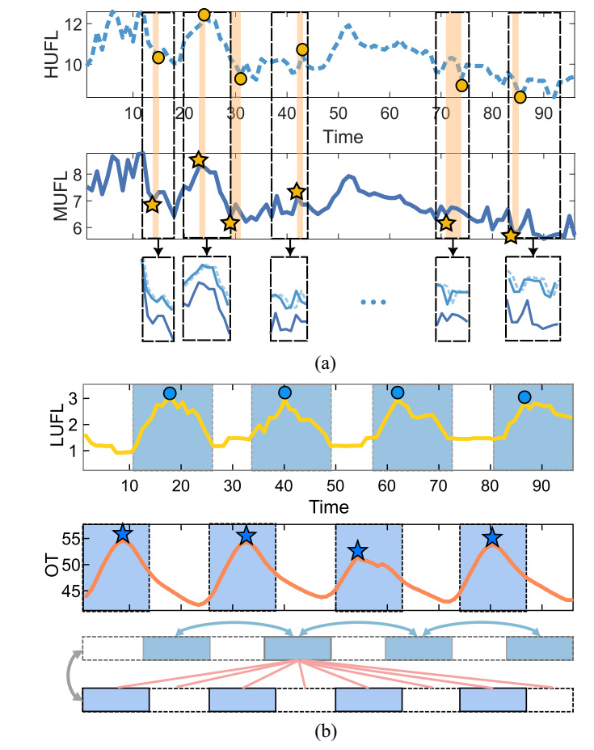
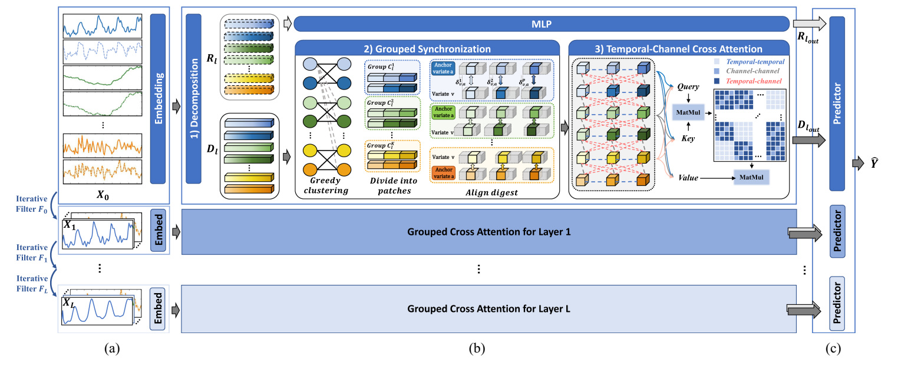
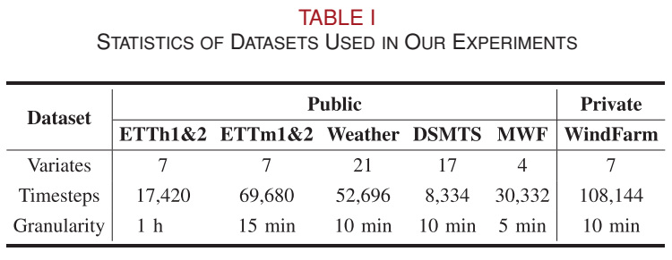
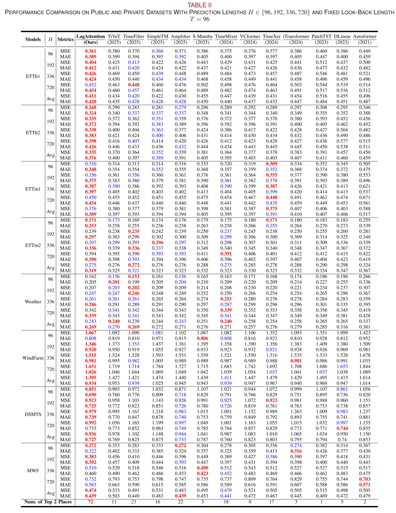
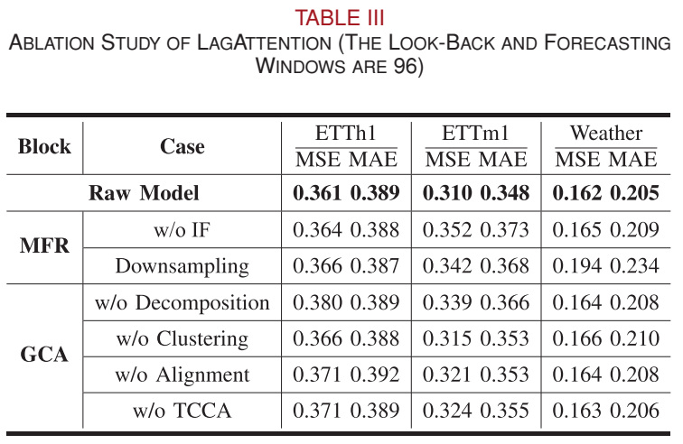
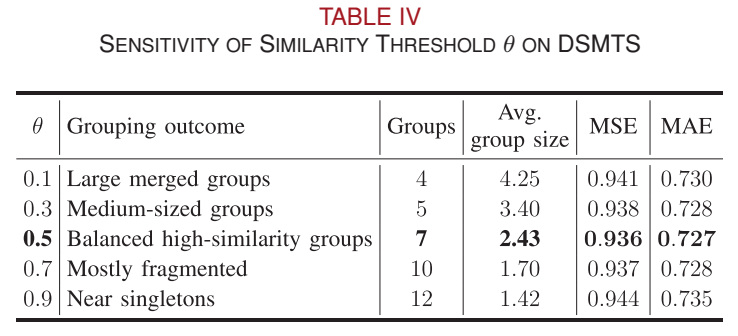
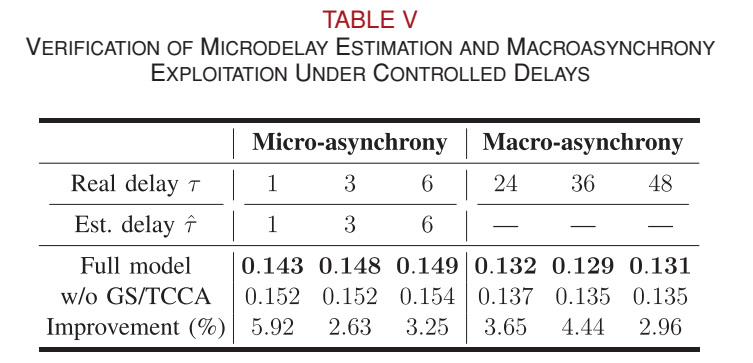
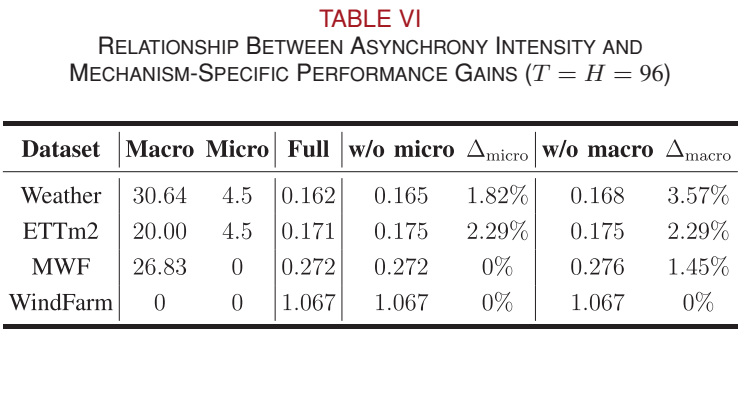
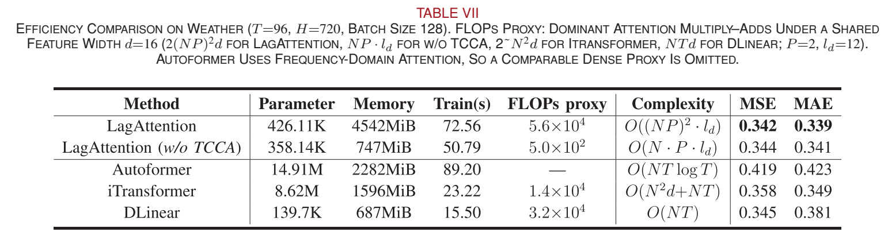

# Overview

Industrial sensors and related variables rarely respond at exactly the same time. A short response delay can misalign two otherwise similar signals, while daily operating schedules can produce much longer phase differences. Treating every variable as synchronized can therefore obscure useful dependencies in multivariate time-series forecasting.

**LagAttention** addresses these two scales together: **microasynchrony**, involving local, pointwise misalignment, and **macroasynchrony**, involving periodic or long-range phase shifts. It combines local alignment within correlated groups with attention across variables and time segments, then merges forecasts from multiple temporal granularities.

The paper has been accepted to **IEEE Transactions on Industrial Informatics (TII)**. The article records acceptance on **August 16, 2026**, with **Ge Wang as corresponding author**. DOI: [10.1109/TII.2026.3727083](https://doi.org/10.1109/TII.2026.3727083).

## At A Glance

| Aspect | Reported setting or finding |
| --- | --- |
| Task | Multivariate forecasting from 96 historical steps |
| Prediction horizons | 96, 192, 336, and 720 steps |
| Evaluation data | Seven public datasets and one private wind-farm dataset |
| Baselines | 12 forecasting methods |
| Top-2 coverage | 72/80 metric entries including Avg rows; 56/64 without Avg rows |
| Average MSE versus iTransformer | Approximately 7.5% lower, as reported across eight datasets |

Top-2 coverage counts dataset, horizon, and metric combinations; it is not a classification accuracy or a count of 80 independent datasets. LagAttention is not best on every individual entry.

## Why Two Kinds Of Asynchrony Matter

**Microasynchrony** can arise from heterogeneous sensor behavior, response delays, or different measurement locations. Related variables may follow similar local patterns but reach corresponding points at slightly different times. LagAttention therefore restricts local synchronization to tightly coupled variable groups rather than forcing unrelated signals into alignment.

**Macroasynchrony** concerns dependencies across longer temporal intervals, such as phase differences between industrial loads and temperature. These dependencies can connect different variables and different segments, so an exclusively local alignment mechanism is insufficient.

<figure class="markdown-figure lagattention-portrait">
  <a href="./assets/asynchrony-examples.jpg" target="_blank" rel="noopener"></a>
  <figcaption>Figure 1. Real-data examples of microasynchrony in ETTm1 and macroasynchrony in ETTh2. Circles and stars mark corresponding, temporally displaced points. Source: the paper, p. 2.</figcaption>
</figure>

## Method: From Multigranularity Features To Lag-Aware Forecasts

<figure class="markdown-figure">
  <a href="./assets/architecture.jpg" target="_blank" rel="noopener"></a>
  <figcaption>Figure 2. LagAttention's three main blocks: multigranularity feature refining (MFR), grouped cross attention (GCA), and multipredictor mixing (MPM). Source: the paper, p. 3.</figcaption>
</figure>

### 1. Multigranularity Feature Refining

Iterative smoothing produces representations that retain fine local fluctuations at lower levels and emphasize coarse variation at higher levels. Each representation is normalized and embedded. Unlike direct downsampling, this design preserves the sequence length while changing the effective temporal granularity.

The grouped cross-attention block decomposes each representation into a **dominant component** and a **residual component**. Alignment and cross attention operate on the structured dominant component, while an MLP processes the residual branch. Their outputs are added before prediction.

### 2. Digestwise Alignment And Grouped Synchronization

The model first forms variable groups with complete-linkage-style greedy clustering and a similarity threshold. The number of groups is not fixed in advance. Within each group, the variable with the highest average similarity to the others becomes an anchor.

Each patch contributes a short representative **digest**. Cosine-similarity search identifies a corresponding digest in each other variable's patch. This makes local alignment more selective than full pointwise matching, while retaining finer timing information than treating a whole patch as a single indivisible object.

The default configuration uses **48-step patches**, **12-step digests**, and a **similarity threshold of 0.5**. Importantly, the paper estimates groups and delays at the beginning of training and reuses them during training and inference. It does **not** continually re-estimate a dynamic delay for every new input. The discrete delay index is treated as constant, with gradients flowing through the selected digest values.

### 3. Temporal-Channel Cross Attention

Temporal-channel cross attention (**TCCA**) treats the digests as tokens. Its attention map can represent within-time, within-channel, and joint cross-time/cross-channel relationships. This supports longer-range dependencies that local within-group synchronization alone cannot capture.

TCCA models macroasynchrony through attention, rather than outputting an explicit scalar macrodelay estimate. It should therefore be distinguished from the local delay search used in grouped synchronization.

### 4. Multipredictor Mixing

Each temporal granularity has its own prediction head. After lag-aware processing, the grain-specific forecasts are **added** to produce the final future sequence. This is additive forecast aggregation, not an extra learned gating network.

## Theoretical Perspective

The paper analyzes three aspects of digest-based modeling:

- **Similarity stability:** under local regularity and nonzero-norm conditions, a small local time shift produces a bounded perturbation of digest cosine similarity. Preserving a ranking also requires a sufficient similarity margin.
- **Information in lagged observations:** under a lag-dominant conditional-independence assumption, a lagged observation is at least as informative as the synchronous one; an approximate version allows a residual dependence term.
- **Digest approximation:** extracting a digest introduces a nonnegative prediction-information gap relative to the full patch. A convergence statement requires a hypothetical nested sequence of representations, not arbitrary longer crops.

These are assumption-dependent results, not a guarantee that alignment always helps. The paper also discusses how within-patch nonstationarity can weaken local regularity and increase information loss.

## Datasets And Evaluation Protocol

| Dataset | Access | Variables | Time steps | Sampling interval |
| --- | --- | ---: | ---: | --- |
| ETTh1 / ETTh2 | Public | 7 | 17,420 each | 1 hour |
| ETTm1 / ETTm2 | Public | 7 | 69,680 each | 15 minutes |
| Weather | Public | 21 | 52,696 | 10 minutes |
| DSMTS | Public, simulated dynamical system | 17 | 8,334 | 10 minutes |
| MWF | Public, manufacturing | 4 | 30,332 | 5 minutes |
| WindFarm | Private, industrial | 7 | 108,144 | 10 minutes |

<figure class="markdown-figure lagattention-compact">
  <a href="./assets/dataset-statistics.jpg" target="_blank" rel="noopener"></a>
  <figcaption>Table I. Dataset statistics. The four ETT variants count as four separate datasets. Source: the paper, p. 7.</figcaption>
</figure>

WindFarm contains seven wind-speed channels collected at Balasu Wind Farm in Yulin, China, from April 2, 2023 to April 21, 2025. All seven channels are both inputs and prediction targets. The paper reports a chronological **70% / 10% / 20%** train/validation/test split, with Z-score normalization fitted only on training data. The raw private data cannot be publicly released; preprocessing scripts and anonymized summary statistics are planned with the code.

The default history length is **96 steps**, with evaluation at four forecasting horizons. Results use **MSE** and **MAE**, where lower is better. The comparison includes TiVaT, TimeFilter, VCformer, SimpleTM, Amplifier, S-Mamba, TimeMixer, TimeXer, iTransformer, PatchTST, DLinear, and Autoformer. The reported training environment uses PyTorch and four NVIDIA GeForce RTX 3090 GPUs with 24 GB memory each.

## Main Forecasting Results

Across the paper's eight datasets, LagAttention obtains Top-2 results in **72 of 80 entries when average rows are included**, and **56 of 64 entries after excluding those averages**. The paper reports approximately **7.5% lower average MSE than iTransformer**. On ETTh2, it reports approximately **12.5% lower MSE than iTransformer** and **4.8% lower than SimpleTM**.

The following values reproduce the **Avg rows of Table II**, averaging over the four horizons. They are dataset-specific normalized errors, not an aggregate score across differently scaled datasets.

| Dataset | LagAttention average MSE | LagAttention average MAE |
| --- | ---: | ---: |
| ETTh1 | 0.411 | 0.420 |
| ETTh2 | 0.335 | 0.376 |
| ETTm1 | 0.376 | 0.389 |
| ETTm2 | 0.275 | 0.319 |
| Weather | 0.243 | 0.269 |
| WindFarm | 1.395 | 0.934 |
| DSMTS | 0.936 | 0.727 |
| MWF | 0.474 | 0.439 |

<figure class="markdown-figure">
  <a href="./assets/forecasting-results.jpg" target="_blank" rel="noopener"></a>
  <figcaption>Table II. Full comparison against 12 baselines with a fixed 96-step history. Red and blue mark the best and second-best results. Source: the paper, p. 8.</figcaption>
</figure>

## What The Ablations Show

Module ablations separately remove iterative filtering, replace it with downsampling, or remove decomposition, clustering, alignment, or TCCA. Table III compares these choices on ETTh1, ETTm1, and Weather with both history and prediction length set to 96. The full model has lower MSE than each listed ablation on these three datasets.

<figure class="markdown-figure lagattention-compact">
  <a href="./assets/ablation-study.jpg" target="_blank" rel="noopener"></a>
  <figcaption>Table III. Module-level evidence for the multigranularity and grouped-attention design. Source: the paper, p. 9.</figcaption>
</figure>

The grouping threshold matters. On the 17-variable DSMTS dataset, a low threshold merges heterogeneous variables, while a high threshold fragments the groups. The reported sweep achieves its lowest average MSE/MAE at **0.5**, producing **seven groups** with an average size of **2.43**. This result supports the chosen threshold in that experiment, not a universal optimum for every dataset.

<figure class="markdown-figure lagattention-compact">
  <a href="./assets/grouping-sensitivity.jpg" target="_blank" rel="noopener"></a>
  <figcaption>Table IV. Sensitivity to the similarity threshold; errors are averaged over the four forecasting horizons. Source: the paper, p. 9.</figcaption>
</figure>

## Does The Model Actually Use Delayed Structure?

### Controlled Delays

In controlled semisynthetic tests, grouped synchronization recovers the known microdelays of **1, 3, and 6 steps**. For longer shifts of **24, 36, and 48 steps**, removing TCCA worsens forecasting. The latter experiment tests exploitation of macrodelay structure; it does not report an explicit macrodelay estimate.

<figure class="markdown-figure lagattention-compact">
  <a href="./assets/controlled-delays.jpg" target="_blank" rel="noopener"></a>
  <figcaption>Table V. Controlled-delay validation separates explicit microdelay estimation from macroasynchrony exploitation. Source: the paper, p. 9.</figcaption>
</figure>

### Gain Versus Measured Asynchrony

Table VI relates component gains to measured asynchronous structure. Removing local alignment hurts Weather and ETTm2, whose measured microasynchrony is nonzero, but not MWF or WindFarm in this setting. Removing macroalignment hurts datasets with measured macroasynchrony. WindFarm has zero measured intensity for both types in this analysis, and neither component changes its reported error.

This is an important boundary on the claim: the mechanisms are intended to help where relevant delayed dependencies exist, rather than improve every dataset through alignment alone.

<figure class="markdown-figure lagattention-compact">
  <a href="./assets/asynchrony-intensity.jpg" target="_blank" rel="noopener"></a>
  <figcaption>Table VI. Mechanism-specific gains versus measured asynchrony, with history and forecast length both set to 96. Source: the paper, p. 9.</figcaption>
</figure>

## Efficiency And Practical Trade-Offs

Short digests reduce the need for full-resolution pairwise alignment, but attention over **N × P** digest tokens still scales quadratically with the number of variables for a fixed patch configuration. A compact parameter count does not imply the lowest memory consumption or training time.

| Method, Weather setting | Parameters | Peak memory | Reported training time | MSE | MAE |
| --- | ---: | ---: | ---: | ---: | ---: |
| LagAttention | 426.11K | 4,542 MiB | 72.56 s | 0.342 | 0.339 |
| Without TCCA | 358.14K | 747 MiB | 50.79 s | 0.344 | 0.341 |
| iTransformer | 8.62M | 1,596 MiB | 23.22 s | 0.358 | 0.349 |
| DLinear | 139.7K | 687 MiB | 15.50 s | 0.345 | 0.381 |

These measurements use **T = 96, H = 720, batch size 128**. Removing TCCA reduces peak memory by approximately **83.6%** and training time by **30.0%** in this comparison, with a small forecasting-error increase. The paper therefore suggests disabling or sparsifying TCCA in resource-constrained settings or where macroasynchrony is negligible. Its attention-operation proxy is not a measurement of total end-to-end FLOPs.

<figure class="markdown-figure">
  <a href="./assets/efficiency-comparison.jpg" target="_blank" rel="noopener"></a>
  <figcaption>Table VII. Accuracy and resource trade-offs under the same Weather evaluation setting. Source: the paper, p. 10.</figcaption>
</figure>

## Resources And Publication Information

- [IEEE Xplore article](https://ieeexplore.ieee.org/abstract/document/11743082)
- [DOI: 10.1109/TII.2026.3727083](https://doi.org/10.1109/TII.2026.3727083)
- **Venue:** IEEE Transactions on Industrial Informatics, 2026.
- **Code:** the article states that code will be released; a public repository URL is not specified in the supplied version.
- **Data:** seven benchmark datasets are public; the raw WindFarm data are private and are not promised as an open download.

The figures and tables above are cropped from the supplied article. The paper and its figures remain subject to the original IEEE rights and permissions.

## Citation

```bibtex
@article{xu2026lagattention,
  title = {LagAttention: Modeling Temporal Asynchrony in Multivariate Time Series Forecasting},
  author = {Xu, Ruiwen and Wang, Ge and Jiang, Junhua and Xu, Jiahao and Liu, Ruihan and Yang, He and Wang, Fei and Xi, Wei},
  journal = {IEEE Transactions on Industrial Informatics},
  year = {2026},
  doi = {10.1109/TII.2026.3727083},
  url = {https://ieeexplore.ieee.org/abstract/document/11743082}
}
```
