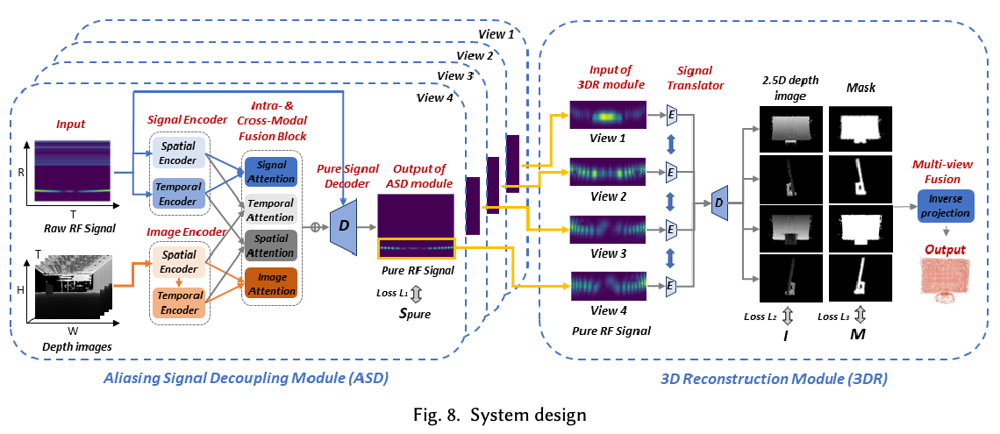
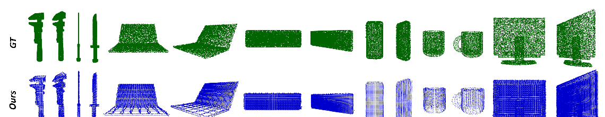
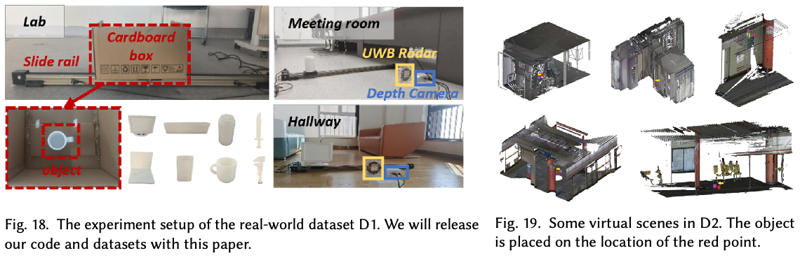
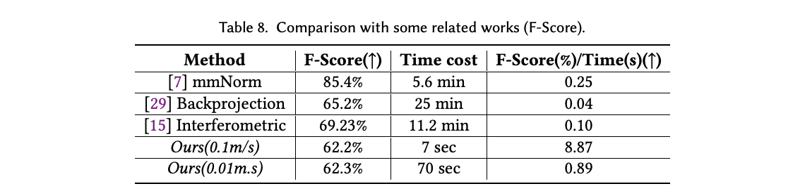

# Overview

Reconstructing an object hidden inside packaging usually requires radio-frequency measurements over a two-dimensional scanning aperture. One2Three investigates a more efficient alternative: **recovering three-dimensional structure from a one-dimensional scan**. A commercial single-transmitter, single-receiver UWB radar captures range-temporal signals as the object moves along a line. A depth camera supplies information about the surrounding scene, helping separate the target's reflections from background clutter.

Published in *Proceedings of the ACM on Interactive, Mobile, Wearable and Ubiquitous Technologies*, **10(3), Article 155, September 2026, 31 pages**. Corresponding author: Ge Wang.

## Main Contributions

- **Linear scanning for 3D reconstruction.** The system replaces a two-dimensional scanning trajectory with one-dimensional motion, a configuration relevant to conveyor-belt inspection and logistics.
- **Aliasing Signal Decoupling (ASD).** Spatial and temporal correlations between RF measurements and depth images isolate object-related signals from environmental reflections.
- **Simulated Multi-Size Synthetic Aperture Radar (SMS-SAR).** Multi-scale convolution learns reconstruction features inspired by synthetic aperture radar, followed by per-view depth prediction and multi-view fusion.
- **Simulation-assisted learning.** Synthetic RF and depth data supplement real measurements, enabling pretraining followed by real-world fine-tuning.

## From Radar Signals To 3D Shape

<figure class="markdown-figure">
  
  <figcaption>Figure 8 from the paper. The ASD module separates target reflections; the 3D reconstruction module predicts per-view geometry and fuses it into a point cloud.</figcaption>
</figure>

| Stage | Input and operation | Output |
| --- | --- | --- |
| Signal acquisition | Linear motion observed by UWB radar and a depth camera | RF range-temporal spectrum and depth frames |
| Background separation | Single-modal encoders and intra-/cross-modal attention model spatial-temporal correspondence | Decoupled target RF signals |
| Geometry prediction | SMS-SAR extracts multi-scale features; a signal translator predicts depth and masks | Per-view 2.5D depth images |
| Multi-view fusion | Inverse projection and fusion combine the predicted views | A reconstructed 3D point cloud |

The depth camera is **not assumed to see the concealed object's shape**. Instead, it provides scene information useful for disentangling moving targets from static background reflections. The model predicts intermediate 2.5D geometry rather than directly regressing a complete point cloud, reducing the complexity of the reconstruction problem.

<figure class="markdown-figure">
  
  <figcaption>Figure 3 from the paper. Examples compare ground-truth shapes with One2Three reconstructions across different object categories.</figcaption>
</figure>

## Datasets And Experimental Setup

<figure class="markdown-figure">
  
  <figcaption>Figures 18 and 19 from the paper. Real-world collection environments and virtual scenes used for simulation-assisted training.</figcaption>
</figure>

| Dataset | Objects and environments | Data |
| --- | --- | --- |
| Real-world D1 | 48 objects from 8 categories; 4 environments | 9,600 augmented sets, each containing four views |
| Generated D2 | 54 ShapeNet objects from 9 categories; 17 WHU-TLS scenes | 91,800 generated and augmented sets |
| Combined scope | 102 objects across 21 real and virtual environments | Used to evaluate modules, training strategies and generalization |

The real-world setup uses an **X4M05 IR-UWB radar**, operating at 7.3 GHz with 1.5 GHz bandwidth and a 40 Hz frame rate, together with an Orbbec Femto Bolt depth camera sampled at 5 Hz. Objects move on a slide rail about 75 cm from the sensor. Experiments include line-of-sight observations and objects packed in opaque cardboard boxes.

## Results And Efficiency

The paper reports **50-200 times less scanning time than two-dimensional scanning at the same scanning speed**. This acquisition advantage should be read alongside the reconstruction-quality trade-off, not as a claim of identical accuracy to every 2D method.

<figure class="markdown-figure">
  
  <figcaption>Table 8 from the paper. Reconstruction quality and time cost for One2Three and related methods, under the reported settings.</figcaption>
</figure>

| Reported setting | Result |
| --- | --- |
| One2Three scanning at 0.1 m/s (Table 8) | 62.2% F-score; 7 seconds |
| One2Three scanning at 0.01 m/s (Table 8) | 62.3% F-score; 70 seconds |
| LoS reconstruction (Table 7) | 5.19 cm Chamfer distance |
| NLoS reconstruction (Table 7) | 5.22 cm Chamfer distance |

The evaluation also studies unseen objects and environments, the number of input views, motion speed, data augmentation, and the amount of real data needed after synthetic pretraining. Together, these experiments examine both acquisition efficiency and how much learned reconstruction transfers beyond the training set.

## Scope And Limitations

One2Three targets cooperative inspection scenarios where an object moves through the sensors' field of view. It supports opaque packaging, but **does not establish through-wall reconstruction**: if an entire opaque obstacle prevents the depth camera from distinguishing moving targets from the background, the separation mechanism may fail. Limited angular diversity and UWB resolution also constrain fine structural detail. Multiple views improve completeness, even though reconstruction with fewer views is evaluated.

## Resources

- [Official ACM publication](https://doi.org/10.1145/3831975)
- Figures and the table above are extracted from the published paper, licensed under CC BY 4.0.

## Citation

```bibtex
@article{wang2026one2three,
  title = {One2Three: 1D Scanning Unlocks High-Fidelity 3D Object Reconstruction},
  author = {Wang, Ge and Chen, Jiazheng and Xiao, Rui and Zhang, Fusang and Wang, Fei and Shi, Shouqian and Ding, Han and Zhao, Cui and Xi, Wei},
  journal = {Proceedings of the ACM on Interactive, Mobile, Wearable and Ubiquitous Technologies},
  volume = {10},
  number = {3},
  articleno = {155},
  numpages = {31},
  year = {2026},
  month = sep,
  doi = {10.1145/3831975},
  publisher = {ACM}
}
```
